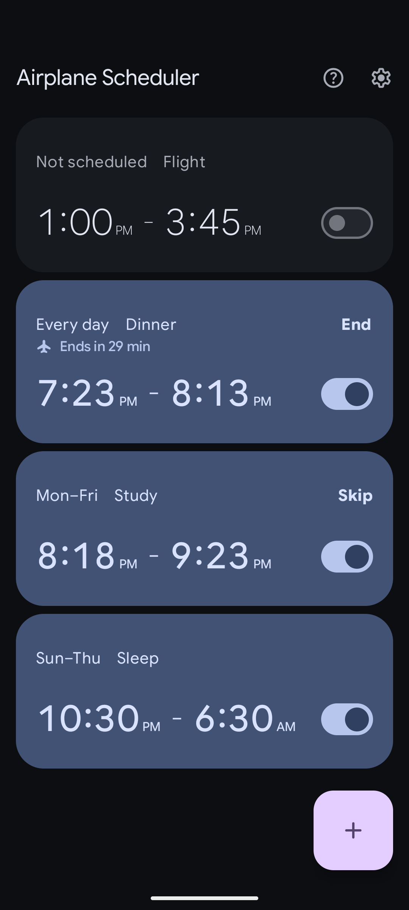
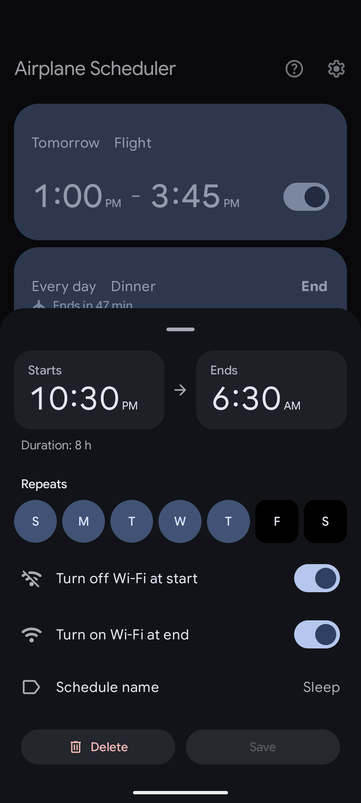
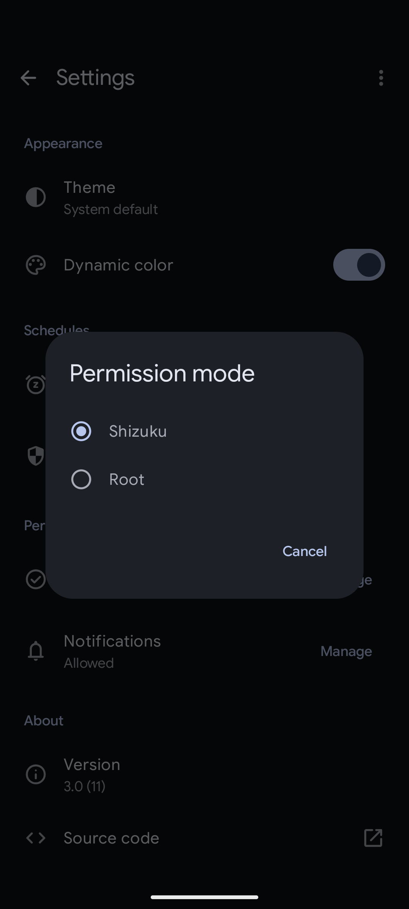

[![Build][build-image]][build-url] [![Version][version-image]][release-url] [![F-Droid][fdroid-image]][fdroid-url]

# Airplane Scheduler

Automatically switch airplane mode on a schedule.

<!-- Badge sourced from https://f-droid.org/badge/get-it-on.png -->
<!-- Badge sourced from https://github.com/Kunzisoft/Github-badge -->
&nbsp;&nbsp;

F-Droid may lag behind new releases. See [Releases][release-url] for the latest build. Both use the same signing key, so you can switch between them without reinstalling.

 

&nbsp;&nbsp;

## Features

- **Flexible schedules.** Run once or repeat on the days you choose.
- **Overnight schedules.** A schedule can continue into the next day.
- **Full control.** Skip, postpone, pause or end a schedule at any time.
- **Wi-Fi control.** Turn off Wi-Fi when a schedule starts, and turn it back on when it ends.
- **Safe by default.** Ending a schedule only reverts changes the app made.
- **Notifications.** Quiet notifications before, during and after a schedule.
- **No internet access, ads or tracking ever.**

## Requirements

- Android 9 or later.
- **Non-root:** [Shizuku-Next](https://github.com/rushiranpise/Shizuku-Next) (recommended) or [Shizuku](https://github.com/RikkaApps/Shizuku).
- **Root:** [Sui](https://github.com/RikkaApps/Sui), or root access through [Magisk](https://github.com/topjohnwu/Magisk) or similar.

## Building

The toolchain is managed with [mise](https://mise.jdx.dev/). Check [mise.toml](mise.toml) for setup and build commands.

## License

[GPL-3.0-or-later](LICENSE).

[build-url]: https://github.com/probecat/airplane-scheduler-app/actions/workflows/ci.yml
[build-image]: https://img.shields.io/github/actions/workflow/status/probecat/airplane-scheduler-app/ci.yml?branch=main
[release-url]: https://github.com/probecat/airplane-scheduler-app/releases/latest
[version-image]: https://img.shields.io/github/v/release/probecat/airplane-scheduler-app?label=version
[fdroid-url]: https://f-droid.org/packages/io.github.probecat.airplanescheduler/
[fdroid-image]: https://img.shields.io/f-droid/v/io.github.probecat.airplanescheduler
