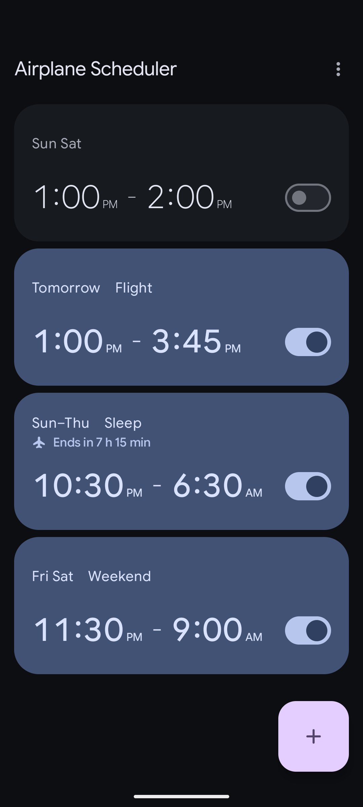
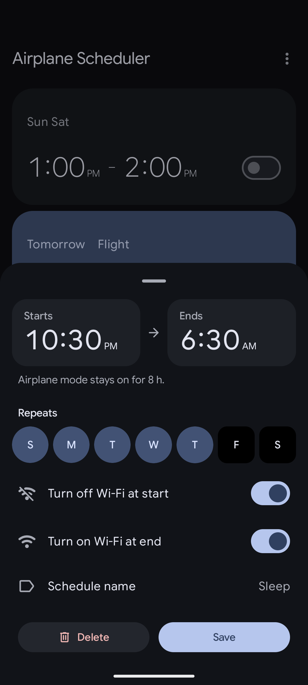
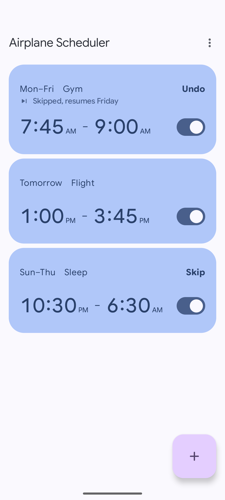

# Airplane Scheduler

[![CI][ci-image]][ci-url] [![Release][release-image]][release-url] [![F-Droid][fdroid-image]][fdroid-url]

Automatically switch airplane mode on and off on a schedule.

  

## Install

  <!-- Badge sourced from https://f-droid.org/badge/get-it-on.png -->
  
  <!-- Badge sourced from https://github.com/Kunzisoft/Github-badge -->
  

F-Droid may lag behind new releases. See [Releases][release-url] for the latest build. Both use the same signing key, so you can switch between them without reinstalling.

## Features

- **Flexible schedules.** One-off or repeating on the days you choose.
- **Overnight schedules.** Schedules can carry over to the next day.
- **Full control.** Skip, postpone, pause or end from the notification.
- **Wi-Fi control.** Off when a schedule starts, back on when it ends.
- **Safe by default.** Ending a schedule undoes only what it changed; anything you change yourself stays.
- **Notifications.** Quiet notifications before, during and after a schedule.
- **No internet access, ads or tracking.**

## Requirements

- Android 9 or later.
- [Shizuku](https://github.com/RikkaApps/Shizuku), or [Sui](https://github.com/RikkaApps/Sui) on a rooted phone.

## Building

The toolchain is managed with [mise](https://mise.jdx.dev/). Check [mise.toml](mise.toml) for setup and build commands.

## License

[GPL-3.0-or-later](LICENSE).

[ci-url]: https://github.com/probecat/airplane-scheduler-app/actions/workflows/ci.yml
[ci-image]: https://github.com/probecat/airplane-scheduler-app/actions/workflows/ci.yml/badge.svg
[release-url]: https://github.com/probecat/airplane-scheduler-app/releases/latest
[release-image]: https://img.shields.io/github/v/release/probecat/airplane-scheduler-app
[fdroid-url]: https://f-droid.org/packages/io.github.probecat.airplanescheduler/
[fdroid-image]: https://img.shields.io/f-droid/v/io.github.probecat.airplanescheduler
